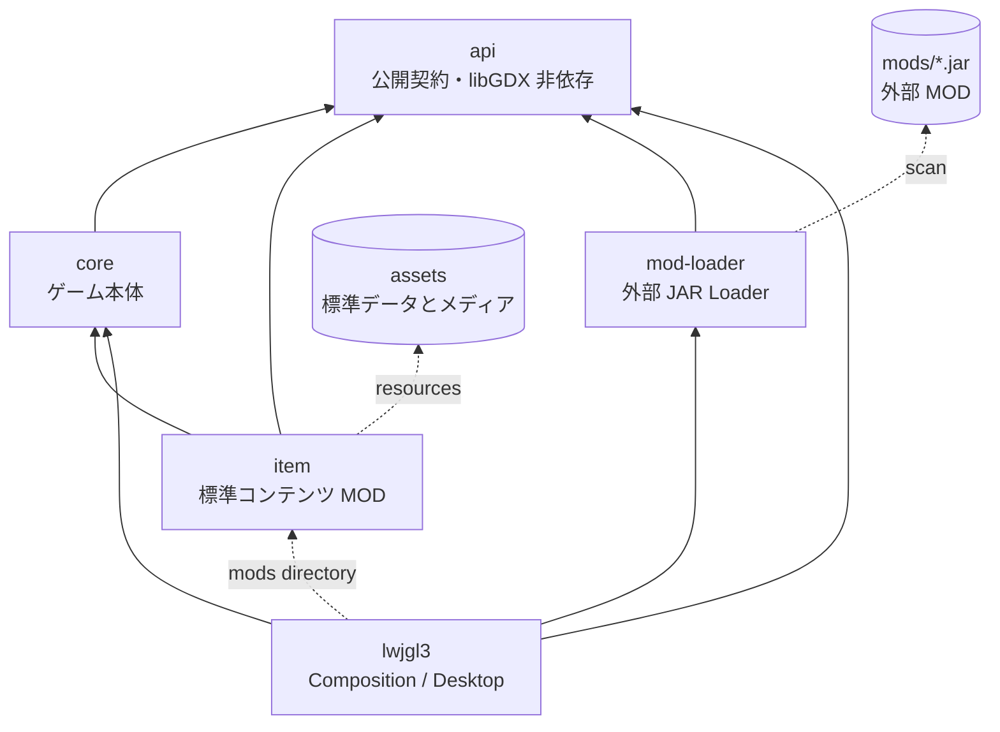
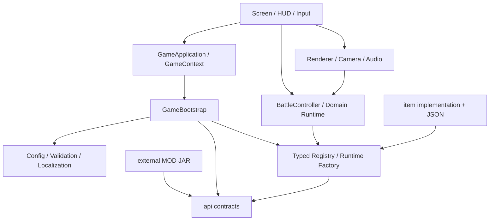
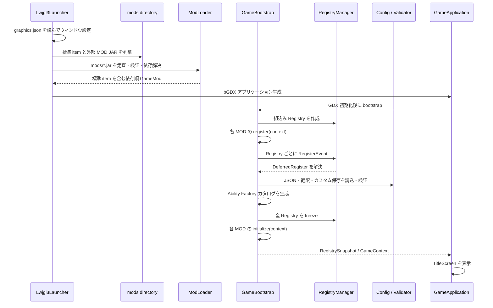
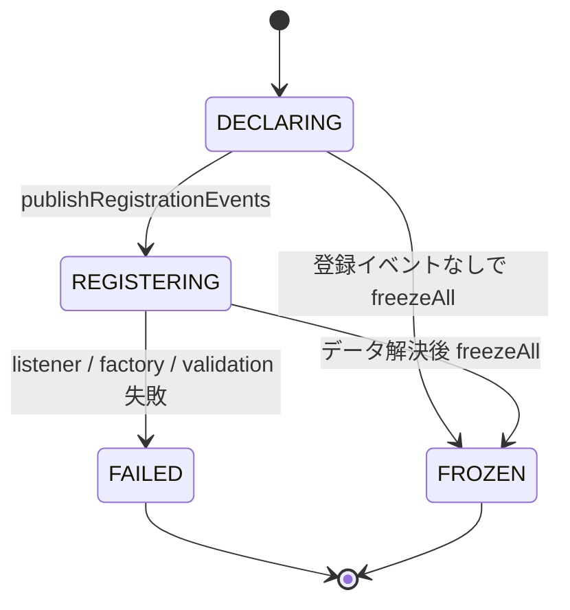
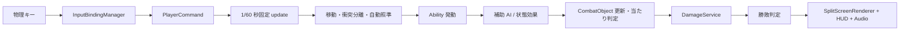
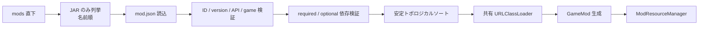

# MojiBattleEX

> **文字が戦う、ローカル 2～4 人対戦 3D アクションゲーム。**
> Java 21 / libGDX 1.14.2 / LWJGL3。ゲーム本体と標準コンテンツを分離し、型付き Registry、イベント、名前空間付きリソース、外部 JAR ローダーを備えます。

## 目次

- [ゲーム概要](#ゲーム概要)
- [動かし方](#動かし方)
- [操作方法](#操作方法)
- [全体アーキテクチャ](#全体アーキテクチャ)
- [起動から終了まで](#起動から終了まで)
- [戦闘ランタイム](#戦闘ランタイム)
- [モジュール別の設計](#モジュール別の設計)
  - [`api`](#api--公開契約)
  - [`core`](#core--ゲーム本体)
  - [`item`](#item--標準コンテンツ-mod)
  - [`mod-loader`](#mod-loader--外部-mod-loader)
  - [`lwjgl3`](#lwjgl3--デスクトップ起動層)
- [データとリソース](#データとリソース)
- [現在の実装状況](#現在の実装状況)
- [実装済みキャラクター](#実装済みキャラクター)
- [MOD の作り方](#mod-の作り方)
- [ソースツリーへコンテンツを追加する方法](#ソースツリーへコンテンツを追加する方法)
- [ビルドと配布](#ビルドと配布)
- [既知の制約と今後の境界](#既知の制約と今後の境界)

---

## ゲーム概要

MojiBattleEX は、メインキャラクターと補助キャラクターでチームを組み、同じ PC 上で戦うゲームです。メインキャラクターは自動通常攻撃、移動、固有スキル、必殺技、パッシブを持ち、補助キャラクターは追従 AI、自動通常攻撃、自動スキル、手動必殺技、常時フィールド効果を持ちます。

| 項目 | 現在の仕様 |
|---|---|
| 対戦人数 | 2～4 人。同一キーボードを使用 |
| ゲームモード | 通常対戦、2～4人対応の超究極スーパーカオス、トレーニング |
| 編成 | 通常: メイン1体＋補助1～2体。カオス: 代表メイン1体＋自動追従メイン2体＋補助4体 / プレイヤー |
| 実装数 | メイン 12 体、補助 6 体、フィールド効果 10 種、VFX 16 種 |
| 試合時間 | 180 秒。残り 60 秒から攻撃倍率 1.5 倍 |
| 更新方式 | 60 Hz 固定時間ステップ（`1 / 60` 秒） |
| 勝敗 | 最後の生存者、または時間切れ時の残 HP **率**。同率は引き分け |
| 表示 | 2 人は左右 2 分割、3～4 人は 2×2 分割、トレーニングは単一プレイヤー視点 |
| カスタム | 最大 10 枠。既存の外観・能力を組み合わせて保存 |
| 言語 | 現在は `ja_jp` |

ゲーム中の文字はフォントの字形ではなく、主に `assets/glyphs/` の画像を 3D 板モデルへ貼って表示します。UI は `NotoSansJP-VF.ttf` から実行時にフォントを生成します。

## 動かし方

### 必要環境

- JDK 21
- Windows / PowerShell（同梱の `gradlew.bat` とパッケージスクリプトを使う場合）
- 外部 MOD を使う場合は、信頼できる JAR のみを配置すること

### 開発実行

プロジェクトルートで次を実行します。

```powershell
.\gradlew.bat lwjgl3:run
```

このタスクは作業ディレクトリを `assets/`、外部 MOD ディレクトリをプロジェクトルートの `mods/` に設定します。`mods/` が存在しなくても起動できます。

```text
MojiBattleEX/
├─ assets/                  # 標準コンテンツの設定・画像・音声・翻訳
├─ mods/                    # 任意。外部 MOD JAR を直下へ置く
├─ api/                     # MOD とホストが共有する公開 Java API
├─ core/                    # ゲームルール、画面、描画、データ読込み
├─ item/                    # 標準コンテンツ MOD
├─ mod-loader/              # 外部 JAR の検出・検証・ロード
├─ lwjgl3/                  # デスクトップ用エントリーポイント
├─ packaging/               # Windows 配布物作成
└─ tools/                   # アセット生成・データ移行補助
```

## 操作方法

| プレイヤー | 移動 | メインスキル | メイン必殺 | 補助スキル | 補助必殺 |
|---|---|---|---|---|---|
| 1P | `W` `S` `A` `D` | `Q` | `E` | `R` | `F` |
| 2P | `↑` `↓` `←` `→` | `,` | `.` | `/` | 右 `Shift` |
| 3P | `I` `K` `J` `L` | `U` | `O` | `Y` | `P` |
| 4P | テンキー `8` `2` `4` `6` | テンキー `7` | テンキー `9` | テンキー `1` | テンキー `3` |
| 共通 | — | — | — | — | 一時停止: `Esc` |

> [!NOTE]
> 補助スキルはクールダウン終了時に自動発動します。補助スキル用キーは入力設定に予約されていますが、現在の戦闘処理では使用されません。補助必殺はキー入力で発動し、メイン必殺とは別のゲージを消費します。

トレーニングでは次のデバッグキーも使えます。

| キー | 動作 |
|---|---|
| `F1` | スキルクールダウンをリセット |
| `F2` | 必殺ポイントを最大化 |
| `F3` | 計測統計をリセット |
| `F4` | 試合経過時間を 30 秒進める |
| `F5` | 覚醒アイテムを出現させる |

---

## 全体アーキテクチャ

### モジュール依存方向



Gradle 上の依存は次のとおりです。

| 呼び出し側 | 依存先 | 種別 | 意図 |
|---|---|---|---|
| `core` | `api` | `api` | 公開 ID・Registry・MOD 契約を利用 |
| `item` | `api`, `core` | `api` | 標準実装は現在まだ core の DTO / 実行型を利用 |
| `mod-loader` | `api` | `api` | 外部 MOD を公開契約だけで生成 |
| `lwjgl3` | `api`, `core`, `mod-loader` | `implementation` | 起動時に全要素を合成 |
| `lwjgl3` | `item` | 配布タスクのみ | Java 型を参照せず標準JARを`mods`へ配置 |

重要な設計規則は以下です。

1. **依存は公開契約へ向ける。** `api` は libGDX に依存せず、MOD とゲーム本体の共通語彙だけを持ちます。
2. **定義と実行状態を分離する。** JSON / Registry には共有可能な定義または Factory を置き、クールダウンなどの可変状態はプレイヤーごとに生成します。
3. **登録期間を限定する。** 起動時に登録し、データ解決後に Registry を凍結します。戦闘中の構造変更は許可しません。
4. **ライフサイクルとゲームプレイを分離する。** 起動用 EventBus と戦闘用 EventBus は別インスタンスです。
5. **描画と戦闘判定を分離する。** `BattleController` はキー入力や画面に依存せず、`PlayerCommand` と固定 `delta` を処理します。
6. **ID を永続的な接点にする。** 実装クラス名ではなく `namespace:path` で実装、定義、VFX、リソースを参照します。

### レイヤー構成



## 起動から終了まで

### 起動シーケンス



登録順の詳細は次のとおりです。

1. `Lwjgl3Launcher` が `graphics.json` をクラスパスから直接読み、LWJGL3 を設定します。
2. 互換用`ServiceLoader<GameMod>`を列挙します。通常配布では空です。
3. `ModLoader` が `mods/` 直下の標準`item`と外部 JAR を検出し、メタデータと依存を検証します。
4. 外部 JAR 群を 1 個の共有 `URLClassLoader` に依存順で載せ、エントリーポイントを生成します。
5. libGDX の `create()` 後、`GameBootstrap` が `BuiltInRegistries` と 2 系統の EventBus を作ります。
6. 全 MOD の `register(ModContext)` を順番に呼びます。この時点では `RegistryHandle#get()` を呼べません。
7. `RegistryManager` が Registry 作成順で `RegisterEvent<T>` を同期配送します。
8. `DeferredRegister` は全 Factory を先に評価・検証し、成功時だけ登録と Handle 束縛を行います。
9. `RegistriesRegisteredEvent` を発行します。
10. 標準 JSON、翻訳、カスタムキャラクター保存を読み、数値・ID・アセット・翻訳参照を検証します。
11. 定義から、プレイヤー専用 Ability を生成する `AbilityRegistry` を作ります。
12. Registry を凍結し、`RegistriesFrozenEvent` を発行します。
13. 全 MOD の `initialize(ModContext)` を呼び、`RegistrySnapshot` を返します。
14. `GameContext` が音声・Skin・共有サービスを所有し、終了時に音声、Skin、EventBus、MOD ClassLoader の順で解放します。

### Registry の状態遷移



- `RegistryId`: `namespace:path` 形式の不変 ID。名前空間なしの旧 ID は `mojibattle` として解釈します。
- `RegistryKey<T>`: Registry 自体の ID と要素型を組にした型付きキーです。
- `Registry<T>`: 登録順を保持し、重複、ID 不一致、凍結後の変更を拒否します。
- `RegistryHandle<T>`: 登録完了後だけ解決できる遅延参照です。
- `DeferredRegister<T>`: 宣言時に `Supplier` を保持し、対応する登録イベントで一括確定します。
- 登録失敗時は全 Registry が `FAILED` になります。内容をロールバックして同じ JVM で再試行する機能はありません。

## 戦闘ランタイム

### 1 フレームの流れ

描画フレームの `delta` は最大 0.25 秒に制限され、`BattleScreen` の accumulator で固定ステップへ分割されます。



`BattleController#update` の実際の順序は、タイマー → 全メイン / パッシブ → 代表移動 → プレイヤー同士の押し戻し → 自動照準・通常攻撃 → 代表のAbility / 補助必殺 → 追従メインAI → 補助AI → 継続ダメージ → フィールド回復 / 交通 → 覚醒 → 戦場オブジェクト → 勝敗 → アナウンスです。

メインの通常攻撃はキャラクターの文字画像と既存の着弾VFXを利用する低威力投射物です。「は」は必殺技の発動後、通常攻撃が寿司へ変化し、発射間隔が通常の0.45倍になります。

### 実行状態の所有権

| 状態 | 所有者 | 共有されるか |
|---|---|---|
| JSON のキャラクター / Ability 定義 | `ConfigManager` / Definition Registry | 起動中共有 |
| Ability 実装 Factory | `BuiltInRegistries` | 起動中共有 |
| スキルのクールダウン・ストック | プレイヤー別 `AbilityLoadout` | 共有しない |
| HP・必殺ポイント・状態効果 | `CharacterRuntime` | 共有しない |
| 代表・追従メイン・補助の編成 | `BattleTeamDefinition`, `PlayerTeam` | プレイヤー単位 |
| 補助の攻撃間隔・ゲージ | `SupportCharacterRuntime` | 共有しない |
| 投射物・召喚物・VFX | `BattleController` | 試合単位 |
| UI / 音声 / RegistrySnapshot | `GameContext` | 画面間共有 |

同じキャラクターを複数プレイヤーが選んでも、Ability の可変状態は混ざりません。必殺技から参照される追加スキルも、そのプレイヤーの `AbilityLoadout` 内で遅延生成・再利用されます。

### ダメージと状態効果

- 通常スキルの設定ダメージには実行時に全体係数 `0.55` が掛かります。
- メイン必殺の設定ダメージには原則として全体係数 `0.65` が掛かります。
- 最終ダメージは、攻撃倍率、終盤倍率、パッシブ、状態効果、フィールド効果、覚醒、会心、防御倍率、防御無視特性を組み合わせて計算します。
- 状態効果は `REFRESH` / `STACK` / `REPLACE` の重複規則と、明示的な永続期間、一度だけの被ダメージ消費を持ちます。
- 公開分類は攻撃、防御相当の被ダメージ、移動、会心率 / 会心倍率、必殺獲得、クールダウン、通常攻撃間隔、継続ダメージ／回復、次回被ダメージです。
- 防御無視は防御倍率だけを迂回し、状態・フィールド由来の被ダメージ補正は引き続き適用します。
- 攻撃生成 (`AttackEvent`) とダメージ確定 (`DamageEvent`) は別イベントです。死亡時は `CharacterDiedEvent` を発行します。

### 戦場オブジェクト

`CombatObject` を共通境界として、投射物、範囲攻撃、直線攻撃、車、巨大回転攻撃、スキル連射、寿司弾幕、家族召喚、覚醒アイテム、VFX を更新します。更新中のリスト変更を避けるため、新規オブジェクトは pending リストへ積み、ステップ末尾で反映します。

---

## モジュール別の設計

## `api` — 公開契約

`api` は外部 MOD がコンパイル時に参照する最小境界です。Java 21 のみで動き、libGDX や `core` へ依存しません。公開 Maven artifact ID は `mojibattle-api` です。

| パッケージ | 主な型 | 役割 |
|---|---|---|
| `mod` | `GameMod`, `ModContext`, `GameApiVersion` | MOD エントリーポイント、API / ゲーム版 |
| `registry` | `Registry`, `RegistryManager`, `DeferredRegister`, `RegistryHandle`, `RegistryId` | 型付き登録、遅延解決、凍結 |
| `event` | `RegistrationBus`, `EventBus`, `EventSubscription` | 同期・登録順・完全一致型のイベント配送 |
| `event.lifecycle` | `RegisterEvent<T>` | Registry ごとの登録タイミング |
| `resource` | `ResourceManager`, `ResourceId`, `ResourceKind` | JAR / クラスパスを隠したストリーム読込み |
| `ability` / `battle` | `SkillRuntime`, `UltimateRuntime`, `PassiveRuntime`, `ConfigView`, `CombatantView`, `CombatActions` | core 型を公開せず独自Abilityを登録・実行する境界 |

設計上のポイント:

- `ModContext` が MOD に渡す EventBus は `RegistrationBus` 型であり、MOD は購読できますがホストイベントを勝手に `post` できません。
- EventBus はイベント型の継承関係をたどらず、**実行時クラスが完全一致**する購読者だけへ同期配送します。
- 配送中に購読を変更しても、現在の配送はスナップショットを使うため次回から反映されます。
- リスナー例外は `EventDispatchException` でイベント型情報を付けて上位へ送ります。
- `ResourceId` は小文字へ正規化され、絶対パス、末尾 `/`、`//`、`.`、`..` を拒否します。
- `ModContext#abilities()`へ登録したFactoryは装備プレイヤーごとに評価され、実行インスタンスの可変状態を共有しません。
- `CombatActions#damage(..., DamageType)`はHPを直接変更せず、攻撃・パッシブ・状態・終盤・防御・会心・統計・`DamageEvent`を含む既存計算を通します。

## `core` — ゲーム本体

`core` はゲームルール、起動の Composition Root、設定解決、画面、描画、音声を実装します。主なサブシステムは次のとおりです。

| 領域 | 主なクラス | 責務 |
|---|---|---|
| アプリ共有 | `GameApplication`, `GameContext` | libGDX lifecycle、共有サービスとリソースの所有 |
| 起動 | `bootstrap.GameBootstrap` | MOD 登録 → データ解決 → Factory 化 → freeze |
| Registry | `BuiltInRegistries`, `RegistrySnapshot` | 9 種の組込み Registry と起動結果 |
| データ | `ConfigManager`, `JsonDataLoader`, `RegistryResolver` | JSON 読込み、旧形式の正規化、ID 解決 |
| 検証 | `GameDataValidator`, `TranslationDataValidator` | 数値、参照、画像、キー割当、翻訳キーの fail-fast 検証 |
| ドメイン | `BattleController`, `CharacterRuntime`, `DamageService` | 固定ステップの戦闘状態とルール |
| Ability | `AbilityRegistry`, `AbilityLoadout`, `IAbility` 系 | 定義からプレイヤー専用実体を生成 |
| 補助 | `SupportController`, `SupportAbilityService`, `FieldEffectSystem` | 追従 AI、自動攻撃、能力、フィールド効果 |
| 状態 | `StatusEffectSystem` | 時間制効果と重複規則 |
| 戦場物 | `domain.combat` | 投射物、範囲 / 直線攻撃、召喚、VFX 等 |
| 入力 | `InputBindingManager` | 物理キーをプレイヤー別 `PlayerCommand` に変換 |
| 画面 | `screen` | タイトル、モード、選択、ガイド、編集、戦闘、設定、結果 |
| 描画 | `ArenaRenderer`, `SplitScreenRenderer`, `PlayerCameraController` | 3D 戦場、分割 viewport、追従カメラ |
| UI | `UiFactory`, `BattleHud` | Skin、ゲージ、Ability 状態、トレーニング情報 |
| 音声 | `BattleAudio` | 8 種の SFX、音量 Preferences、同時発音制限 |
| 永続化 | `CustomCharacterStore` | バージョン付きカスタム保存、検証、一時ファイル置換 |

組込み Registry は以下の 9 個です。

| Registry | 保持するもの |
|---|---|
| `skill_implementations` | スキルの Factory・検証・UI 表示生成 |
| `ultimate_implementations` | 必殺技の Factory・検証・UI 表示生成 |
| `passive_implementations` | パッシブの Factory・検証・UI 表示生成 |
| `field_effect_implementations` | フィールド効果の種別と検証 |
| `support_ability_implementations` | 補助 Ability のハンドラと検証 |
| `effects` | VFX ID、画像、倍率、用途、旧 index |
| `skill_definitions` | JSON から読んだスキル定義 |
| `ultimate_definitions` | JSON から読んだ必殺技定義 |
| `passive_definitions` | JSON から読んだパッシブ定義 |

`ConfigManager` は旧 JSON の `type`、整数 VFX index、暗黙翻訳キーを現行 ID へ正規化します。互換処理は読込み境界へ集約し、以降のランタイムは安定 ID だけを扱います。

## `item` — 標準コンテンツ MOD

`item` はゲーム本体に同梱される標準コンテンツですが、起動側からは通常の外部`GameMod`として扱われます。開発・配布タスクが標準JARを`mods`へ配置し、metadataのentrypointから`ItemContentModule`を生成します。Service Provider定義は旧配置との互換用です。

```text
item/
├─ src/main/java/.../item/
│  ├─ ItemContentModule.java       # GameMod エントリーポイント
│  ├─ init/                        # ID と DeferredRegister の宣言
│  └─ impl/
│     ├─ registry/                 # Factory・検証・表示定義
│     └─ ability/                  # 実際の Ability 実装
└─ src/main/resources/META-INF/
   ├─ mojibattle/mod.json          # 標準 MOD metadata
   └─ services/...GameMod          # ServiceLoader 登録
```

`init` と `impl` の分離には、ID の一覧と実装詳細を混ぜず、起動側が個別クラスを知らなくても一括登録できる利点があります。`ItemContentModule#register` は 6 個の `DeferredRegister` を lifecycle bus へ attach するだけです。

| カタログ | 実装済み ID | 数 |
|---|---|---:|
| スキル | `projectile`, `bind_follow_up`, `self_attack_buff`, `random_economy` | 4 |
| 必殺技 | `area`, `self_heal`, `line`, `meteor_shower`, `summon_family`, `moving_car`, `spinning_one`, `skill_barrage`, `sushi_barrage`, `cash_crash` | 10 |
| パッシブ | `compound_interest`, `hitbox_boost`, `ultimate_regen`, `damage_guard`, `speed_boost`, `ultimate_gain`, `stun_boost`, `skill_haste`, `family_bond`, `difficult_kanji`, `berserker`, `ultimate_boost`, `cash_scatter` | 13 |
| 補助 Ability | `ally_attack_up`, `enemy_defense_down`, `enemy_attack_down`, `heal_cleanse`, `bonus_damage`, `wide_slash`, `enemy_slow`, `right_teleport`, `wind_pull`, `global_cooldown_halve`, `train_charge`, `gather_all` | 12 |
| フィールド効果 | `critical_enable`, `cooldown`, `move_multiplier`, `periodic_heal`, `damage_taken`, `speed_pulse`, `attack_growth`, `projectile_curve`, `traffic`, `express_maki` | 10 |
| VFX | `neutral` ～ `family`（旧 index 0～15） | 16 |

`item` の `sourceSets.main.resources` はルートの `assets/` を指すため、標準設定・画像・音声・翻訳は標準コンテンツ JAR に同梱されます。

> [!IMPORTANT]
> 分離は移行途中です。`SkillImplementation`、Ability DTO、実行インターフェースなどがまだ `core` にあるため、現在の `item` は `core` に依存します。目標の `item -> api` のみという境界にはまだ到達していません。

## `mod-loader` — 外部 MOD Loader

`mod-loader` は `mods/*.jar` を扱います。処理は **全件検証してからロード**する fail-fast 方式で、途中までロードした不完全な一覧を返しません。



### 検出規則

- `mods/` **直下**の通常ファイルかつ拡張子 `.jar` のみを対象にします。
- サブディレクトリ、シンボリックリンク、非 JAR は走査しません。
- ファイル名順で読み、実体パスが重複する JAR を拒否します。
- `META-INF/mojibattle/mod.json` が必須です。
- MOD JAR が `jp/takoa/mojibattle/{battle,content,event,mod,registry,resource}/` を同梱している場合、API の二重ロードを避けるため拒否します。

### 検証と依存解決

- metadata schema は現在 `1` のみです。
- MOD ID は正規化済み小文字で、`mojibattle_game` はホスト予約 ID、`mojibattle` は標準コンテンツIDです。
- API major は `1`、ゲームバージョンは `0.1.0` です。
- semantic version は厳密な `major.minor.patch` のみです。prerelease / build metadata は扱いません。
- `gameVersion` は完全一致または `>=x.y.z` を受け付けます。
- dependency range は空文字または `>=x.y.z` のみです。
- required の欠落、存在する optional の版不足、自己依存、循環、MOD ID 重複を拒否します。
- required と、実在する optional の両方を順序制約に含め、MOD ID で安定化したトポロジカル順を作ります。
- metadata の ID と `GameMod#id()` が一致しない場合はロード失敗です。

### ClassLoader と信頼境界

外部 MOD は全 JAR を URL に持つ **単一の共有 `URLClassLoader`** へロードされ、親 ClassLoader から Game API を取得します。この方式は単純ですが、MOD ごとの依存ライブラリ隔離は行いません。同じライブラリの異なる版を複数 MOD が同梱すると競合する可能性があります。

また ClassLoader はセキュリティサンドボックスではありません。MOD はゲームと同じ OS 権限で任意コードを実行できます。署名検証、権限制限、プロセス分離は実装されていません。

## `lwjgl3` — デスクトップ起動層

`lwjgl3` は唯一のデスクトップエントリーポイントです。

- `graphics.json` から 1600×900 / windowed などの初期値を読む
- VSync を有効化し、foreground FPS を 120 に設定する
- 標準 MOD と外部 MOD を合流させる
- `GameApplication` へ遅延 `GameContext` Factory を渡す
- Java 21 `jpackage` タスクを定義する
- 標準 `item` JARを開発・配布の`mods`へコピーし、通常クラスパスから分離する

初期 graphics の読込みは libGDX 起動前なので、ここだけは `ResourceManager` ではなくクラスパスリソースを直接使います。

---

## データとリソース

### 名前空間付き配置

公開 `ResourceManager` は、物理配置を隠して `open` / `exists` / `list` を提供します。

```text
assets/<modid>/...   # 画像、音声、翻訳などの ASSET
data/<modid>/...     # JSON 定義などの DATA
```

たとえば `new ResourceId("examplemod", "characters/example.json")` と `ResourceKind.DATA` は、JAR 内の `data/examplemod/characters/example.json` を表します。

標準名前空間 `mojibattle` だけは後方互換として、従来のルート配置も検索します。

```text
config/characters/kabushiki.json
i18n/ja_jp.json
glyphs/kabushiki.png
```

`ModResourceManager#list` は外部 MOD JAR 内を列挙できます。`ClasspathResourceManager#list` は現在空リストを返すため、クラスパス上の標準リソース列挙には使えません。

### 標準データの構成

| パス | 内容 |
|---|---|
| `assets/config/game.json` | 言語、音量、メイン / 補助 / フィールド効果 ID 一覧 |
| `assets/config/battle.json` | 時間、固定ステップ、アリーナ、全体倍率、カオスモードHP倍率 |
| `assets/config/graphics.json` | ウィンドウ、カメラ |
| `assets/config/controls.json` | 4 プレイヤーのキー |
| `assets/config/critical.json` | 基本会心率・倍率 |
| `assets/config/awakening.json` | 覚醒出現時刻、倍率、画像 |
| `assets/config/custom_editor.json` | 保存枠、選択上限、保存版 |
| `assets/config/characters/*.json` | メインの基礎値と Ability ID |
| `assets/config/abilities/*.json` | スキル、必殺、パッシブ定義 |
| `assets/config/support/*.json` | 補助 AI 値、能力、フィールド効果 |
| `assets/config/field_effects/*.json` | 戦場全体の効果 |
| `assets/i18n/*.json` | UI / Ability 文言 |

読込み時には、ファイル名と定義 ID の一致、ID 重複、正の能力値、倍率範囲、Registry 参照、画像の存在、VFX 用途、Ability 固有条件、キー重複、翻訳キーを検証します。補正できない不整合は起動時例外になります。

### カスタムキャラクター

ゲーム内エディターは新しいコードや画像を作るものではなく、既存コンテンツを組み合わせます。

- メイン: 既存外観 + スキル 1 + 必殺 1 + パッシブ最大 3
- 補助: 既存外観 + 補助スキル 1 + 補助必殺 1 + フィールド効果最大 2
- 最大 10 枠
- 保存先: libGDX external storage の `MojiBattleEX/custom-characters.json`
- 保存形式 version: `1`
- `.tmp` へ書いて再読込み検証後、可能なら atomic move で本体を置換
- 読込みエラーはゲーム起動を止めず、保存枠を破棄して UI 用エラーとして保持

---

## 現在の実装状況

凡例: ✅ 実装済み / 🟡 部分実装・移行中 / ⛔ 未実装

| 領域 | 状態 | 現在できること / 制約 |
|---|:---:|---|
| ローカル対戦 | ✅ | 2～4 人、KO / 時間切れ / 引き分け |
| トレーニング | ✅ | 不死のダミー、統計・状態・倍率表示、F1～F5 |
| 固定ステップ | ✅ | 60 Hz、描画 delta 上限、入力を command 化 |
| 分割画面 | ✅ | 2 人左右、3～4 人 2×2、独立追従カメラ |
| メインキャラクター | ✅ | 12体、共通自動通常攻撃、個別スキル / 必殺 / パッシブ |
| 補助キャラクター | ✅ | 6体、通常時1～2体・カオス時4体編成、横並びHUD、追従・自動攻撃・自動スキル・手動必殺 |
| カオスモード | ✅ | 2～4チーム、各チームは操作メイン1体・自動追従メイン2体・補助4体。メインの最大HPは `battle.json` の `chaosHealthMultiplier` 倍 |
| 状態効果 | ✅ | 公開11分類、3重複規則、永続期間、期限切れ復元、一度だけの消費 |
| フィールド効果 | ✅ | 10 種、ID 重複排除、周期 / 時間成長 |
| 覚醒 | ✅ | 残り 30 秒で出現、攻撃 1.5 / 防御 1.5 / 移動 1.3 / 必殺獲得 1.5 倍 |
| 戦闘演出 | ✅ | 16 VFX、板ポリゴン、回転 / 脈動、命中フラッシュ、カメラシェイク |
| 音声 | ✅ | 8 SFX、音量保存、同一フレームの同時発音制限 |
| 画面遷移 | ✅ | タイトル、モード、選択、ガイド、編集、設定、戦闘、ポーズ、結果 |
| キャラクター編集 | ✅ | 10 枠、外観と能力の再構成、検証付き保存 |
| JSON / I18n | ✅ | UTF-8、旧形式正規化、参照 / 翻訳検証 |
| 型付き Registry | ✅ | 遅延登録、Handle、失敗状態、freeze |
| MOD JAR 検出 | ✅ | metadata、版、依存、循環、API 同梱を検証 |
| MOD リソース | ✅ | stream / exists / JAR list、外部Texture変換、標準互換フォールバック |
| MOD lifecycle | ✅ | `register`、Registry event、`initialize` |
| 外部 MOD の独自 Java 処理 | ✅ | メイン／補助Ability、固定更新、ダメージhook、汎用攻撃・状態・HUDを公開APIで実装可能 |
| 外部データパック | ✅ | ContentRegistrarからcharacter / skill / ultimate / passive / 翻訳を統合 |
| 外部画像 / 音声の実ゲーム利用 | 🟡 | キャラクター・攻撃・VFX画像は対応。外部音声とUIテーマは未公開 |
| 公開 API だけのキャラクター追加 | ✅ | 既存Ability実装をJSONから再利用する方式に対応 |
| MOD ごとの ClassLoader 隔離 | ⛔ | 全外部 MOD が 1 個の共有 ClassLoader |
| MOD サンドボックス / 署名 | ⛔ | 信頼済み JAR 前提 |
| 自動テスト | ✅ | API入力、core戦闘、外部MOD bootstrap、API 0.6バイナリ互換fixtureを`check`で実行 |

### 画面と UX

| 画面 | 実装内容 |
|---|---|
| タイトル | 対戦、設定、カスタムキャラクター編集へ遷移 |
| モード選択 | 通常・超究極スーパーカオスそれぞれの2 / 3 / 4人戦、トレーニング、キャラクターガイド |
| キャラクター選択 | カードグリッド、詳細、確定 / キャンセル、補助1 / 2体切替、カオス専用3メイン＋4補助編成プレビュー |
| ガイド | メイン / 補助の表示切替、実装 Registry 由来の能力説明 |
| 戦闘 HUD | HP、スキル、必殺、人数で等分した横並び補助ゲージ、中央アナウンス、終盤表示 |
| トレーニング HUD | 与ダメージ、DPS、フィールド、パッシブ倍率、位置、状態効果等 |
| 設定 | 解像度、全画面、音量、UI 倍率、カメラ追従、言語 / キー表示 |
| 結果 | 勝者 / 引き分けとタイトル復帰 |

設定画面は Preferences へ値を保存します。音量は戦闘音声が毎フレーム保存値を参照し、解像度・全画面・カメラ追従は操作中に反映されます。一方、起動時ウィンドウ設定は現在 `graphics.json` を直接読むため、保存済み解像度 / 全画面を launcher が復元する経路は未統合です。UI 倍率も保存 UI はありますが、Skin / viewport へ適用する経路は未統合です。

## 実装済みキャラクター

`battle.healthMultiplier = 2.5` のため、表には JSON 基礎 HP と実戦 HP を併記します。カオスモードでは、その実戦HPへさらに `battle.chaosHealthMultiplier`（初期値 `5.0`）を乗算します。説明中のダメージは主に JSON 設定値であり、実戦では全体係数や各種倍率が適用されます。

### メインキャラクター（12 体）

| 文字 / ID | HP（基礎 → 実戦） | 移動 | スキル | 必殺技 | パッシブ / 特徴 |
|---|---:|---:|---|---|---|
| ㍿ `kabushiki` | 1000 → 2500 | 5.0 | **株価上昇**: 4 発 + 落下ビル | **倒産**: ビル 2 個、広範囲 | 30 秒ごと攻撃 +5%、最大 1.5 倍 |
| い `hiragana_i` | 920 → 2300 | 6.2 | **いろは弾**: 2 stock、ブーメラン、広判定 | **五十音暴走**: 半径 9.5 | 当たり判定 1.4 倍 |
| ∫ `integral` | 1100 → 2750 | 4.6 | **積分波**: 数式 4 発 | **無限積分領域**: 数式 5 個の連続落下 | 必殺ポイント毎秒 +0.45 |
| 1 `one` | 1800 → 4500 | 6.8 | **ブラッド・ワンショット**: HP 8% 消費、高威力 | **唯一無二大回転**: 5 秒回転 + 回復 | HP 減少に応じ攻撃上昇、最大 2.8 倍 |
| D `d_letter` | 1000 → 2500 | 8.8 | **ドライブスラッシュ**: 高速 3 発 | **D・デッドヒート**: 車 4 台、14 秒 | 移動速度 1.28 倍 |
| ㌔ `kilometer` | 900 → 2250 | 7.2 | **キロ加速砲**: 8 方向 | **メガトン換算**: 同スキルを 10 連射 | 必殺獲得 1.45 倍 |
| 短 `short` | 700 → 1750 | 7.4 | **短距離連斬**: 短射程・スタン | **知の濃縮**: 巨大「単位」落下、設定威力 1500 | スタン時間 1.6 倍 |
| 🤩 `star_struck` | 1000 → 2500 | 5.8 | **スターラッシュ**: 隕石 7 発 | **スーパースター**: 隕石 24 個 | スキル CD 0.68 倍 |
| A `a_letter` | 800 → 2000 | 7.0 | **fAmily**: 32 方向 | **家族総出でお出迎えします**: 家族 6 体召喚 | 家族 1 体ごと攻撃 +6%、最大 2 倍 |
| 𰻞 `biang` | 1050 → 2625 | 5.8 | **くそでかスプーン**: 拘束 → 巨大スプーン追撃 | **𰻞𰻞麺**: 範囲 + 5 秒炎上 | 5% で 0.5 秒妨害、内部 CD 5 秒 |
| は `ha` | 960 → 2400 | 6.4 | **寿司の香り**: 8 秒攻撃 1.25 倍 | **寿司爆撃**: 防御無視寿司 20 発 | 必殺ダメージ 1.2 倍 |
| ㍻ `heisei` | 1050 → 2625 | 6.2 | **技術革新**: 攻防のランダム相場効果 | **バブル崩壊**: 範囲 + 被ダメージ増加 9 秒 | 4 秒ごと札束、最大 12 個 |

### 補助キャラクター（6 体）

| 文字 / ID | 自動スキル | 手動必殺 | フィールド効果 | 特徴 |
|---|---|---|---|---|
| T `t` | 味方攻撃 +40%、10 秒 | 敵防御低下、10 秒 | 会心率 +30%、CD 0.9 倍 | 会心支援 |
| 0 `zero` | 敵攻撃 0.45 倍、9 秒 | 最大 HP 5% 回復 + 負状態解除 | 移動 0.9 倍、10 秒ごとメイン 1% 回復 | 編成メインを防御 0 扱いにする代償 |
| / `slash` | 追加ダメージ +45%、8 秒 | 威力 420、射程 30 の広域斬撃 | 被ダメージ 1.1 倍、15 秒周期で 3 秒間速度 1.2 倍 | 攻撃間隔 0.7 秒 |
| 右 `right` | 敵移動 0.55 倍、7 秒 | 右方向転移 / 位置制御 | 60 秒ごと攻撃 +2%（最大 +10%）、弾道湾曲 | 曲射投射物 |
| 松 `matsu` | 風で引き寄せ | 全スキル CD 半減 | 7 秒ごとの交通オブジェクト | 補助通常攻撃に会心あり |
| 薪 `maki` | 射程 38 の列車突撃、威力 50 | 全員を集合 | 専用 `express_maki` 1.25 倍 | 高速追従 |

### フィールド効果（10 種）

| ID | type | 効果 |
|---|---|---|
| `collapse` | `critical_enable` | 全員の会心率へ 0.30 加算 |
| `resonance` | `cooldown` | 全員の CD を 0.90 倍 |
| `absolute_zero` | `move_multiplier` | 全員の移動を 0.90 倍 |
| `creation_from_zero` | `periodic_heal` | 10 秒ごとにメインを最大 HP の 1% 回復 |
| `crack` | `damage_taken` | 全員の被ダメージを 1.10 倍 |
| `split_time` | `speed_pulse` | 15 秒周期の先頭 3 秒、移動 1.20 倍 |
| `rising_right` | `attack_growth` | 60 秒ごとに攻撃 +2%、最大 +10% |
| `deflection` | `projectile_curve` | 投射物を湾曲 |
| `matsudo` | `traffic` | 7 秒周期、持続 11 秒、交通波を生成 |
| `express_maki` | `express_maki` | 専用倍率 1.25 |

### 共通のバランス設定

| 設定 | 値 |
|---|---:|
| 試合時間 | 180 秒 |
| 終盤開始 | 残り 60 秒 |
| 終盤攻撃倍率 | 1.5 |
| HP 全体倍率 | 2.5 |
| スキル CD 全体倍率 | 0.8 |
| 移動の実行時全体倍率 | 1.2 |
| スキル実行ダメージ係数 | 0.55 |
| メイン必殺実行ダメージ係数 | 0.65 |
| 覚醒出現 | 残り 30 秒 |

---

## MOD の作り方

### 先に知っておくべき対応範囲

現在、外部 MOD として公式に安定して使えるのは次の範囲です。

- JAR の検出、metadata / バージョン / 依存検証
- `GameMod#register` と `GameMod#initialize` の呼出し
- `RegisterEvent` の購読と、既知 `RegistryKey<T>` に対する `DeferredRegister`
- `assets/<modid>` / `data/<modid>` の open / exists / list
- `ContentRegistrar`によるメインキャラクターと3種類のAbility JSONの登録
- `ContentRegistrar`による補助キャラクターと対象条件付きフィールド効果JSONの登録
- `AbilityImplementationRegistrar`によるメイン／補助の独自Ability実装登録
- 状態、動的会心、通常攻撃modifier、Projectile、範囲・遅延攻撃、HUD状態行
- 外部翻訳とキャラクター／攻撃／VFX Textureの読込み

公開`api`だけで、メイン・補助キャラクターと独自Java Abilityの双方を追加できます。
一方、次の範囲はまだ未公開です。

1. 外部音声とUIテーマの登録
2. MOD単位の依存ライブラリ隔離

以下はデータ駆動キャラクターMODの作り方です。APIだけへ`compileOnly`依存する完成例と結合テストは`external-api-test-mod`にあります。

### 1. API をローカル Maven へ発行する

```powershell
.\gradlew.bat :api:publishToMavenLocal
```

現在の座標は次のとおりです。

```text
jp.takoa.mojibattle:mojibattle-api:0.7.0
```

### 2. MOD プロジェクトを作る

`build.gradle.kts` の最小例です。API はゲームが供給するため `compileOnly` にし、MOD JAR へ同梱しません。

```kotlin
plugins {
    java
}

group = "com.example"
version = "1.0.0"

repositories {
    mavenLocal()
    mavenCentral()
}

java {
    toolchain.languageVersion.set(JavaLanguageVersion.of(21))
}

dependencies {
    compileOnly("jp.takoa.mojibattle:mojibattle-api:0.7.0")
}
```

### 3. JAR 構造を作る

```text
examplemod.jar
├─ META-INF/mojibattle/mod.json
├─ com/example/examplemod/ExampleMod.class
├─ assets/examplemod/i18n/ja_jp.json
├─ assets/examplemod/textures/example.png
├─ data/examplemod/characters/example.json
└─ data/examplemod/abilities/*.json
```

外部 MOD は Service Provider ファイルを必要としません。metadata の `entrypoint` を loader が直接生成します。

### 4. metadata を書く

`src/main/resources/META-INF/mojibattle/mod.json`:

```json
{
  "schemaVersion": 1,
  "id": "examplemod",
  "name": "Example MOD",
  "version": "1.0.0",
  "apiVersion": "1",
  "gameVersion": ">=0.1.0",
  "entrypoint": "com.example.examplemod.ExampleMod",
  "dependencies": {
    "required": {
      "mojibattle_game": ">=0.1.0",
      "mojibattle": ">=0.1.0"
    },
    "optional": {}
  }
}
```

| キー | 必須 | 規則 |
|---|:---:|---|
| `schemaVersion` | ✅ | 現在は `1` |
| `id` | ✅ | 小文字 `[a-z0-9_.-]+`、`mojibattle_game` は不可 |
| `name` | ✅ | 空文字不可 |
| `version` | ✅ | 厳密な `x.y.z` |
| `apiVersion` | ✅ | 現在は major `1` |
| `gameVersion` | ✅ | `x.y.z` または `>=x.y.z` |
| `entrypoint` | ✅ | public な引数なし constructor を持つ `GameMod` 実装 |
| `dependencies.required` | ✅ | 欠落時はロード失敗 |
| `dependencies.optional` | ✅ | 存在時だけ版と順序を検証 |

### 5. エントリーポイントを書く

```java
package com.example.examplemod;

import jp.takoa.mojibattle.mod.GameMod;
import jp.takoa.mojibattle.mod.ModContext;
import jp.takoa.mojibattle.content.CharacterDataRegistration;
import jp.takoa.mojibattle.resource.ResourceId;

public final class ExampleMod implements GameMod {
    @Override
    public String id() {
        return "examplemod"; // metadata.id と完全一致させる
    }

    @Override
    public void register(ModContext context) {
        context.content().registerCharacter(new CharacterDataRegistration(
                resource("characters/example.json"),
                resource("abilities/example_skill.json"),
                resource("abilities/example_ultimate.json"),
                resource("abilities/example_passive.json"),
                "i18n"));
    }

    private ResourceId resource(String path) {
        return new ResourceId(id(), path);
    }
}
```

独自Abilityは同じ`register`内で実装IDへFactoryを登録します。JSONの`parameters`は
`ConfigView`として渡され、JSONライブラリなどホスト内部実装への依存は不要です。数値、真偽値、文字列、配列、ネストしたオブジェクトを読み取れます。

```java
context.abilities().registerSkillImplementation("examplemod:return_to_forest", parameters -> {
    float damage = parameters.floatValue("damage", 40f);
    float distance = parameters.floatValue("knockbackDistance", 1.25f);
    return activation -> {
        var target = activation.target();
        if (target == null) return false;
        activation.actions().damage(activation.user(), target, damage, DamageType.SKILL);
        activation.actions().knockbackAwayFrom(activation.user(), target, distance);
        return true;
    };
});
```

スキルJSON側では登録した実装IDと固有パラメータを指定します。

```json
{
  "id": "examplemod:return_to_forest",
  "implementationId": "examplemod:return_to_forest",
  "cooldownSeconds": 3.0,
  "parameters": {
    "damage": 40,
    "knockbackDistance": 1.25
  }
}
```

### 6. ビルドして配置する

```powershell
.\gradlew.bat jar
Copy-Item .\build\libs\examplemod-1.0.0.jar C:\path\to\MojiBattleEX\mods\
```

Gradle からゲームを起動する場合は、プロジェクトルートの `mods/` へ置きます。配布版では起動プロセスの作業ディレクトリにある `mods/` を使います。独自の起動スクリプトを作る場合は、JVM system property `mojibattle.modsDir` で別ディレクトリを指定できます。通常の `lwjgl3` JAR は依存 JAR と組み合わせて起動する構成なので、単体の `java -jar` ではなく `installDist` / `jpackage` のランチャーを使用してください。

### MOD の失敗条件チェックリスト

- [ ] JAR は `mods/` 直下にある
- [ ] metadata の全必須値がある
- [ ] `id()` と metadata ID が一致する
- [ ] API を JAR に同梱していない
- [ ] version / range が対応形式である
- [ ] required dependency が存在し、必要版以上である
- [ ] 循環依存がない
- [ ] リソースの名前空間が MOD ID と一致する
- [ ] リソースパスに空要素、`.`、`..` がない
- [ ] `register` 中に未束縛 Handle を読んでいない
- [ ] 信頼できるコードだけを導入している

## ソースツリーへコンテンツを追加する方法

標準コンテンツを本体リポジトリ内で追加する場合は、次の手順を使います。外部MODとして追加する場合は、前節の`ContentRegistrar`方式を使うため本体の再ビルドは不要です。

### 既存実装を使うメインキャラクター

1. `assets/glyphs/` や `assets/objects/` に必要画像を置きます。
2. `assets/config/characters/<id>.json` を作り、`type`, `id`, HP、速度、当たり判定、`skillId`, `ultimateId`, `passiveId`, `glyphTexture` を設定します。
3. 次の 3 ファイルを作ります。
   - `assets/config/abilities/<id>_skill.json`
   - `assets/config/abilities/<id>_ultimate.json`
   - `assets/config/abilities/<id>_passive.json`
4. 各 Ability の `implementationId` に、`item` が登録済みの実装 ID を指定します。
5. `assets/config/game.json` の `characterIds` に ID を追加します。
6. `assets/i18n/ja_jp.json` に名前・説明キーを追加します。
7. 起動時検証で、ID、値、画像、VFX 用途、翻訳の不足がないことを確認します。

最小のキャラクター定義イメージ:

```json
{
  "id": "example",
  "type": "MAIN",
  "displayGlyph": "例",
  "nameKey": "character.example.name",
  "maxHp": 1000,
  "baseAttack": 1.0,
  "moveSpeed": 6.0,
  "collisionRadius": 0.65,
  "skillId": "example_skill",
  "ultimateId": "example_ultimate",
  "passiveId": "example_passive",
  "glyphTexture": "glyphs/example.png"
}
```

### 新しい実装方式を追加する

JSON だけで表現できない挙動は、次の 3 層を追加します。

1. **実行クラス**: `item/impl/ability` に `ISkill` / `IUltimate` / `IPassive` 実装を追加する。
2. **実装記述子**: `item/impl/registry/*Implementations` で Factory、固有 validator、UI presentation を組にする。
3. **登録宣言**: `item/init/*RegistryInit` の `DeferredRegister` に安定 ID で登録する。

設定 DTO に新しい値が必要なら `core/domain/ability/AbilityConfigs` も変更します。ランタイムで新しい戦場オブジェクトが必要なら `core/domain/combat` と `BattleController#updateObjects`、表示が必要なら `ArenaRenderer` も更新します。

### 補助キャラクター

1. `assets/config/support/<id>.json` を作ります。
2. 追従速度、距離、射程、攻撃間隔、弾速、必殺自然増加を設定します。
3. `skill.type` / `ultimate.type` に登録済み `SupportAbilityImplementation` ID を指定します。
4. `fieldPassiveIds` に 1 個以上のフィールド効果 ID を指定します。
5. `game.json#supportIds` と翻訳を更新します。

### フィールド効果

1. 既存 type を使うなら `assets/config/field_effects/<id>.json` だけを追加します。
2. 新しい計算方式なら `FieldEffectRegistryInit` と `FieldEffectImplementations` に type を追加し、`BattleController` / `FieldEffectSystem` の適用箇所を実装します。
3. `game.json#fieldEffectIds` に ID を追加します。

---

## ビルドと配布

### 主な Gradle コマンド

Core ゲームと標準コンテンツ MOD を個別に生成する方法は [`build-tools/README.md`](build-tools/README.md) を参照してください。

```powershell
# Java runtime、標準MOD、example MOD同梱の実行可能EXE
.\build-tools\build-playable-package.ps1

# 全モジュールのビルド
.\gradlew.bat build

# デスクトップ実行
.\gradlew.bat lwjgl3:run

# API をローカル Maven へ発行
.\gradlew.bat :api:publishToMavenLocal

# デスクトップ配布用ディレクトリ
.\gradlew.bat :lwjgl3:installDist

# 標準コンテンツ MOD JAR
.\gradlew.bat :item:jar
```

### Windows パッケージ

Java 21 の `jpackage` を使い、Java runtime 同梱の配布物を生成します。

```powershell
# 展開不要でEXEを直接起動できるapp-image
.\build-tools\build-playable-package.ps1

# WiX 不要の portable ZIP
.\gradlew.bat :lwjgl3:jpackagePortableZip

# WiX Toolset が必要な EXE installer
.\gradlew.bat :lwjgl3:jpackageWindowsExe

# ZIP、EXE、SHA-256 を一括生成
.\gradlew.bat :lwjgl3:packageRelease
```

| 種類 | 出力 |
|---|---|
| 直接実行可能なEXE | `lwjgl3/build/jpackage/app-image/MojiBattleEX/MojiBattleEX.exe` |
| 同梱MOD | `lwjgl3/build/jpackage/app-image/MojiBattleEX/app/mods/` |
| Portable ZIP | `lwjgl3/build/jpackage/distributions/MojiBattleEX-<version>-windows-x64.zip` |
| Installer | `lwjgl3/build/jpackage/installer/MojiBattleEX-<version>.exe` |
| Checksum | `lwjgl3/build/jpackage/distributions/SHA256SUMS.txt` |

詳しくは [`build-tools/README.md`](build-tools/README.md) を参照してください。`jpackage` はクロス OS パッケージングを行わないため、各 OS 用配布物は対象 OS 上で作成します。

### アセット補助

| ツール | 用途 |
|---|---|
| `tools/generate-battle-sfx.ps1` | 戦闘 SFX 生成 |
| `tools/generate-heisei-maki-assets.ps1` | 平成 / 薪関連アセット生成 |
| `tools/migrate-registry-json.ps1` | 旧 JSON の Registry ID 移行補助 |

生成素材の記録は [`assets/GENERATED_ASSETS.md`](assets/GENERATED_ASSETS.md)、個別素材の由来は各アセットディレクトリの `README.md` にあります。

## 既知の制約と今後の境界

優先度の高い未完了事項は以下です。

1. 標準コンテンツ内部のAbility DTOも公開設定境界へ移し、`item -> core`依存をなくす。
2. 外部音声とUIテーマの公開登録契約を追加する。
3. MOD 単位の依存ライブラリ隔離方針を決める。
4. launcher 起動時に保存済み graphics Preferences を適用し、UI scale を実表示へ反映する。

現時点では、公開APIとJSONだけでメイン／補助キャラクター、Ability、状態、フィールド効果、通常攻撃変化、HUD状態表示を追加できます。外部音声とUIテーマは安定契約として扱わないでください。

---

## 関連資料

README 単体で全体像が分かるよう内容を統合していますが、設計判断や監査記録の原文は以下に残しています。

- [`docs/ARCHITECTURE.md`](docs/ARCHITECTURE.md) — MOD アーキテクチャの短縮版
- [`docs/MOD_DEVELOPMENT.md`](docs/MOD_DEVELOPMENT.md) — 外部 MOD 仕様の短縮版
- [`docs/MIGRATION_PHASES.md`](docs/MIGRATION_PHASES.md) — Phase 1～9の実装記録
- [`docs/JAVADOC_AUDIT.md`](docs/JAVADOC_AUDIT.md) — Javadoc 監査
- [`docs/STATIC_CHECK_REPORT.md`](docs/STATIC_CHECK_REPORT.md) — 静的確認記録
- [`packaging/README.md`](packaging/README.md) — Windows リリース作成
