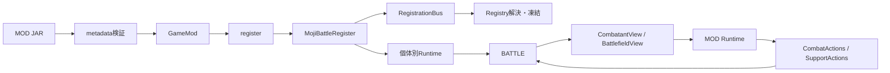

# MojiBattleEX MOD API 0.8.2

MojiBattleEX MOD APIは、外部MODとゲーム本体を分離する公開Java契約です。MODはこのAPIだけへコンパイル時依存し、`core`、`item`、libGDX、JSON・描画実装へ依存せず、コンテンツ登録、Ability実装、戦闘操作、リソース参照を行えます。

- Maven: `jp.takoa.mojibattle:mojibattle-api:0.8.2`
- Java 21 / API 0.8.2 / API major 1 / game 0.8.2 / metadata schema 1
- APIはゲームが実行時に供給するため、MODでは必ず`compileOnly`にします。

## 目次

1. [最短導入](#最短導入)
2. [設計とアーキテクチャ](#設計とアーキテクチャ)
3. [ライフサイクル](#ライフサイクル)
4. [コンテンツとリソース](#コンテンツとリソース)
5. [Ability実装](#ability実装)
6. [戦闘個体と戦場](#戦闘個体と戦場)
7. [戦闘操作](#戦闘操作)
8. [状態・ダメージ・通常攻撃](#状態ダメージ通常攻撃)
9. [補助キャラクター](#補助キャラクター)
10. [決闘・対象固定・分裂](#決闘対象固定分裂)
11. [Registryとイベント](#registryとイベント)
12. [全公開クラス](#全公開クラス)
13. [検証・互換性・制約](#検証互換性制約)
14. [更新履歴](#更新履歴)
15. [テストと配布](#テストと配布)

## 最短導入

### APIを発行して依存する

```powershell
.\gradlew.bat :api:publishToMavenLocal
```

```kotlin
plugins { java }
group = "com.example"
version = "1.0.0"

repositories { mavenLocal(); mavenCentral() }
java { toolchain.languageVersion.set(JavaLanguageVersion.of(21)) }

dependencies {
    compileOnly("jp.takoa.mojibattle:mojibattle-api:0.8.2")
}
```

### metadata

`src/main/resources/META-INF/mojibattle/mod.json`:

```json
{
  "schemaVersion": 1,
  "id": "examplemod",
  "name": "Example MOD",
  "version": "1.0.0",
  "apiVersion": "1",
  "gameVersion": ">=0.8.2",
  "entrypoint": "com.example.examplemod.ExampleMod",
  "dependencies": {
    "required": { "mojibattle_game": ">=0.8.2" },
    "optional": {}
  }
}
```

標準コンテンツを前提にする場合はrequiredへ`"mojibattle": ">=0.8.2"`も追加します。

### 最小エントリーポイント

```java
@ModEntry()
public final class ExampleMod implements GameMod {
    private static final MojiBattleRegister<CharacterDataRegistration> CHARACTERS = MojiBattleRegister.create(MojiBattleRegistries.CHARACTERS, "examplemod");
    private static final MojiBattleRegister<SkillImplementation> SKILLS = MojiBattleRegister.create(MojiBattleRegistries.SKILL_IMPLEMENTATIONS, "examplemod");

    static {
        CHARACTERS.register("example", () -> new CharacterDataRegistration(
                resource("characters/example.json"), resource("abilities/example_skill.json"),
                resource("abilities/example_ultimate.json"), resource("abilities/example_passive.json"), "i18n"));

        SKILLS.register("strike", () -> new SkillImplementation("examplemod:strike", config -> activation -> {
            if (activation.target() == null) return false;
            activation.actions().damage(activation.user(), activation.target(),
                    DamageRequest.of(config.floatValue("damage", 40f), DamageType.SKILL));
            return true;
        }, config -> { }, (config, multiplier) -> AbilityPresentation.of("examplemod.skill.strike")));

    }

    @Override public String id() { return "examplemod"; }

    @Override public void register(ModContext context) {
        CHARACTERS.attach(context.registrationBus());
        SKILLS.attach(context.registrationBus());
    }

    private static ResourceId resource(String path) { return new ResourceId("examplemod", path); }
}
```

### JAR構造

```text
examplemod.jar
├─ META-INF/mojibattle/mod.json
├─ com/example/examplemod/ExampleMod.class
├─ assets/examplemod/i18n/ja_jp.json
├─ assets/examplemod/glyphs/example.png
├─ data/examplemod/characters/example.json
└─ data/examplemod/abilities/*.json
```

`jar`タスクでビルドし、完成JARをMojiBattleEXの`mods/`直下へ置きます。

## 設計とアーキテクチャ

| 層 | 責務 | MODからの直接依存 |
|---|---|---|
| `api` | DTO、View、操作・登録境界 | 許可 |
| `core` | 戦闘状態、固定ステップ、衝突、検証、描画接続 | 不可 |
| `item` | 標準コンテンツMOD | 原則不可 |
| `mod-loader` | JAR・metadata・依存関係・ClassLoader | 不可 |
| `lwjgl3` | デスクトップ起動・配布 | 不可 |



設計原則:

- API型はcore型、item型、libGDX、特定JSONライブラリを公開しません。
- 読取りはView、変更はActionsへ分離します。
- IDとリソースは`namespace:path`で衝突を防ぎます。
- Runtimeは装備者・補助個体ごとにFactory生成されます。可変戦闘状態をstatic共有しません。
- 時間制処理は描画フレームではなくホストの固定ステップで進みます。
- record生成時とcore境界の両方でnull、所有権、有限値、範囲を検証します。
- 既存interfaceへの機能追加は原則defaultメソッドで行います。

## ライフサイクル

1. loaderが全metadata、バージョン、依存関係を検証する。
2. 依存順に`GameMod`を生成する。
3. `GameMod#register`でコンテンツ、Runtime Factory、MojiBattleRegisterを宣言する。
4. `RegisterEvent<T>`をRegistry作成順に同期配送する。
5. データ解決後にRegistryを凍結する。
6. `GameMod#initialize`を1回呼ぶ。
7. 戦闘ごと・個体ごとにRuntimeを生成する。

`register`中に未束縛の`RegistryHandle#get()`を呼んだり、戦闘状態を生成したりしてはいけません。`initialize`は追加登録ではなく、解決済み参照の初期化用です。

`PassiveRuntime#update`は固定ステップごとに呼ばれ、ポーズ中と勝敗確定後は呼ばれません。戦闘ViewやContextを次の試合まで保持しないでください。

## コンテンツとリソース

### 配置とID

```text
assets/<modid>/...  # 画像、翻訳など
data/<modid>/...    # キャラクター、Ability、フィールド効果JSON
```

`ResourceId`と`RegistryId`は`namespace:path`形式です。絶対パス、空要素、`.`、`..`、重複スラッシュは拒否されます。

```java
ResourceId texture = ResourceId.parse("examplemod:glyphs/group.png");
try (InputStream in = context.resources().open(ResourceKind.ASSET, texture)) {
    // streamの所有権は呼出側
}
```

`ResourceManager`は`open`、`exists`、辞書順の`list`を提供します。`ClasspathResourceManager`は互換用で、`list`は空一覧です。通常は`context.resources()`を使います。

### データ登録

```java
MojiBattleRegister<CharacterDataRegistration> characters = MojiBattleRegister.create(MojiBattleRegistries.CHARACTERS, "examplemod");
characters.register("group", () -> new CharacterDataRegistration(
        id("characters/group.json"), id("abilities/group_skill.json"),
        id("abilities/group_ultimate.json"), id("abilities/group_passive.json"), "i18n"));
characters.attach(context.registrationBus());
```

`CharacterDataRegistration`の4 DATAリソースは同じnamespaceである必要があります。translation directoryが`i18n`なら`assets/<modid>/i18n/<language>.json`を参照します。補助JSONでは外観、移動、通常攻撃、スキル、必殺、パッシブ、parametersに加え、0.8.1では`maxHp`と`defense`を指定できます。未指定maxHpは100です。

## Ability実装

| Registry要素 | Runtime | 生成単位 |
|---|---|---|
| `SkillImplementation` | `SkillRuntime` | メイン個体 |
| `UltimateImplementation` | `UltimateRuntime` | メイン個体 |
| `PassiveImplementation` | `PassiveRuntime` | 装備個体 |
| `SupportAbilityImplementation` | `SupportAbilityRuntime` | 補助個体 |
| `SupportPassiveImplementation` | `SupportPassiveRuntime` | 補助個体 |

登録IDとJSONの`implementationId`または補助Abilityの`type`を一致させます。

### ConfigView

FactoryにはAbility定義の公開フィールドとJSON `parameters`を統合した`ConfigView`が渡されます。`stringValue`、`floatValue`、`intValue`、`booleanValue`、`objectValue`、`listValue`を利用できます。

```java
SKILLS.register("burst", () -> new SkillImplementation("examplemod:burst", config -> {
    float damage = config.floatValue("damage", 30f);
    int count = config.intValue("count", 3);
    return activation -> {
        CombatantView target = activation.target();
        if (target == null || !target.alive()) return false;
        activation.actions().spawnProjectile(activation.user(), target,
                new ProjectileSpec(DamageRequest.of(damage, DamageType.SKILL),
                        14f, .35f, 2.5f, count, 24f, 1,
                        ResourceId.parse("examplemod:glyphs/shot.png"),
                        ResourceId.parse("mojibattle:wind")));
        return true;
    };
}, config -> { }, (config, multiplier) -> AbilityPresentation.of("examplemod.skill.burst")));
```

`SkillRuntime#activateFromUltimate`は既定で`tryActivate`へ委譲します。発動成立時は`true`、対象不在などで不成立なら`false`を返します。

### PassiveRuntime

`update`、スキル・必殺通知、必殺倍率、会心率加算、防御無視、通常攻撃Modifier、HUD状態行、与ダメージ・被ダメージ通知を実装できます。各倍率・一覧は利用時に再評価されます。

```java
PASSIVES.register("growing", () -> new PassiveImplementation("examplemod:growing", config -> new PassiveRuntime() {
    private float elapsed;
    @Override public void update(PassiveUpdateContext c) { elapsed += c.deltaSeconds(); }
    @Override public float ultimateDamageMultiplier(CombatantView owner) {
        return elapsed >= 30f ? 1.25f : 1f;
    }
    @Override public List<AbilityStateLine> stateLines(CombatantView owner) {
        return List.of(AbilityStateLine.of("examplemod.growing", 50, Math.round(elapsed)));
    }
}, config -> { }, config -> AbilityPresentation.of("examplemod.passive.growing")));
```

HUD状態行はpriority降順、翻訳キー順で最大8件表示されます。`DamageEventContext.dealtDamage()`は基礎値ではなくHPへ実際に入った確定値です。

## 戦闘個体と戦場

### CombatantView

| メソッド | 内容 |
|---|---|
| `id()` | キャラクター定義ID。同じ定義なら敵味方で同じになり得る |
| `instanceId()` | 試合内で一意な個体ID |
| `kind()` | `MAIN` / `SUPPORT` / `SUMMON` |
| `hp()` / `maximumHp()` | 現在・最大HP |
| `ultimatePoints()` / `maximumUltimatePoints()` | 必殺ゲージ |
| `alive()` | 生存状態 |
| `defenseMultiplier()` | 防御込みの現在被ダメージ倍率 |
| `position()` | libGDX非依存の`CombatantPosition` |

状態キー、対象固定、決闘、召喚追跡には`id()`ではなく`instanceId()`を使います。

### BattlefieldView

```java
BattlefieldView field = context.actions().battlefield();
List<CombatantView> everyone = field.livingCombatants();
List<CombatantView> allies = field.alliesOf(context.owner());
List<CombatantView> enemies = field.enemiesOf(context.owner());

CombatantView target = enemies.stream()
        .max(Comparator.comparing(CombatantView::maximumHp))
        .orElseThrow();
```

生存中で戦場に現れているMAIN、SUPPORT、SUMMONを統一列挙します。分裂中に隠された元補助は除外され、分裂召喚は含まれます。返される一覧は変更できません。

`SupportView`は補助Ability制御と専用ゲージ用です。補助のHP、防御、位置、生存状態が必要なら、`BattlefieldView`から同じ`instanceId()`を持つ`CombatantView`を取得します。

```java
CombatantView supportCombatant = context.actions().battlefield().livingCombatants().stream()
        .filter(c -> c.instanceId().equals(context.support().instanceId()))
        .findFirst().orElseThrow();
```

## 戦闘操作

`CombatActions`は所属戦闘だけを変更できる境界です。別試合のViewや偽造Viewは拒否されます。

| 分類 | メソッド |
|---|---|
| 戦場 | `battlefield`, `alliesOf`, `enemiesOf` |
| ダメージ | 3種の`damage`、`DamageRequest`、`DamageResult` |
| 回復・ゲージ | `heal`, `healRatio`, `addUltimatePoints`, `refundUltimatePoints` |
| 状態 | `applyStatus`, `cleanseNegativeStatuses`, `stun`, `bind` |
| 攻撃生成 | `spawnDelayedStrike`, `spawnProjectile`, `spawnProjectilePattern`, `spawnAreaAttack`, `spawnFallingStrike`, `spawnLineAttack`, `spawnMovingHazards`, `spawnSpinningAttack`, `startSkillBarrage`, `startProjectileBarrage`, `startBattlefieldPulse` |
| 召喚・設置 | `summonCompanions`, `spawnDetonatableMarker`, `detonateOwnedMarkers` |
| 位置 | `knockbackAwayFrom`, `pullToward`, `teleportBesideTarget`, `swapPositions`, `mirrorAcrossArenaCenter`, `gatherMainCombatantsAtCenter` |
| 演出 | `emitEffect`, `activateDomain`, `isDomainActive`, `showCutIn` |
| 特殊戦闘 | `startDuel`, `lockNormalAttackTarget` |

攻撃Spec:

- `DelayedStrikeSpec`: 対象を追跡し指定時間後に1回攻撃
- `ProjectileSpec`: 速度、半径、寿命、弾数、扇角、hit数、texture、effect
- `ProjectilePatternSpec` / `ProjectileShotSpec`: 弾ごとの文字、画像、配置、ダメージ、拘束と追撃・ブーメラン・落下追撃
- `AreaAttackSpec`: 生成時の対象位置を固定し、遅延後に範囲攻撃
- `FallingStrikeSpec`, `LineAttackSpec`, `MovingHazardSpec`, `SpinningAttackSpec`: 標準コンテンツと外部MODが共有できる特殊攻撃
- `SkillBarrageSpec`, `ProjectileBarrageSpec`, `CompanionSummonSpec`, `DetonationSpec`: 連続発動、召喚、設置物起爆
- `BattlefieldPulseSpec`: 一定時間の中央吸引と周期ダメージ

演出Spec:

- `DomainSpec` / `DomainVisualStyle`: 重複可能な視覚領域。能力値効果は暗黙に持たない
- `CutInSpec` / `CutInMotion`: 画像、翻訳キー、時間、priority、カメラ意図、強度

## 状態・ダメージ・通常攻撃

### ダメージ

`DamageRequest`はbaseDamage、`NORMAL`/`SKILL`/`ULTIMATE`、常時防御無視、会心時防御無視を持ちます。`DamageResult`は実ダメージ、会心成立、防御無視成立を返します。

正式経路では攻撃倍率、種別倍率、会心、防御、状態、フィールド、決闘補正、統計、イベントを適用します。防御無視は防御倍率を迂回しますが、状態・フィールド由来の被ダメージ補正は維持されます。

### 状態

```java
actions.applyStatus(source, target, StatusSpec.multiplier(
        ResourceId.parse("examplemod:marked"),
        StatusEffectType.INCOMING_DAMAGE_MULTIPLIER,
        1.4f,
        StatusDuration.seconds(6f)));
```

`StatusEffectType`:

- `ATTACK_MULTIPLIER`, `INCOMING_DAMAGE_MULTIPLIER`, `MOVE_SPEED_MULTIPLIER`
- `CRITICAL_RATE_ADDITION`, `CRITICAL_DAMAGE_MULTIPLIER`
- `ULTIMATE_GAIN_MULTIPLIER`, `SKILL_COOLDOWN_MULTIPLIER`
- `NORMAL_ATTACK_INTERVAL_MULTIPLIER`
- `DAMAGE_OVER_TIME`, `HEAL_OVER_TIME`
- `NEXT_INCOMING_DAMAGE_MULTIPLIER`, `BONUS_DAMAGE_MULTIPLIER`

期間は`StatusDuration.seconds`または`permanent`です。Infinityを使いません。再付与は`REPLACE`、`REFRESH`、`ADD_STACK`、消費契機は`NONE`または`ON_DAMAGE_RECEIVED`です。

### 通常攻撃Modifier

`NormalAttackModifier`はメイン用で、パッシブから攻撃ごとに返します。間隔・ダメージは乗算、弾数・hit数deltaと扇角は加算、texture/effectはpriorityとID順で決定します。

`SupportNormalAttackModifier`は補助用で、`ADD`、`MULTIPLY`、`REPLACE`を持ちます。`SupportActions`で永続または時間制追加、一覧取得、ID削除ができます。同じIDの再追加はその補助個体の旧値を置換します。

## 補助キャラクター

`SupportAbilityActivationContext`は`support`、代表メイン`owner`、現在の`target`、`actions`、`config`、戦闘経過秒、`supportActions`、`state`を提供します。

`SupportPassiveRuntime`のフック:

- `onBattleStart`, `update`, `onBattleEnd`
- `onSkillActivated`, `onUltimateActivated`
- `onNormalAttack`
- `stateLines`

`SupportStateStore`は`int`、`float`、`boolean`、`String`を補助`instanceId`ごとに保存します。同じ定義が敵味方や同一チームにいても共有されず、戦闘終了後は無効です。

`NormalAttackEvent`は多段数・弾数に関係なく攻撃動作1回につき1回通知されます。観測補助から見たALLY/ENEMYと、MAIN/SUPPORT/SUMMONを持ちます。

```java
SUPPORT_PASSIVES.register("counter", () -> new SupportPassiveImplementation("examplemod:counter", config ->
        new SupportPassiveRuntime() {
            @Override public void onNormalAttack(SupportPassiveContext c, NormalAttackEvent e) {
                if (e.attackerInstanceId().equals(c.support().instanceId()))
                    c.state().putInt("count", c.state().getInt("count", 0) + 1);
            }
            @Override public List<AbilityStateLine> stateLines(SupportPassiveContext c) {
                return List.of(AbilityStateLine.of("examplemod.count", 100,
                        c.state().getInt("count", 0)));
            }
        }));
```

人数連動攻撃倍率:

```java
context.supportActions().setBattlefieldCountAttackMultiplier(
        ResourceId.parse("examplemod:headcount"), 20, 1f, .05f);
```

実効値は`baseMultiplier + multiplierPerCombatant * livingCombatants`です。MAIN、SUPPORT、SUMMONを数え、攻撃時に再計算し、既存補助Modifierと乗算します。

## 決闘・対象固定・分裂

### 決闘

```java
CombatantView enemy = actions.battlefield().enemiesOf(owner).stream()
        .max(Comparator.comparing(CombatantView::maximumHp)).orElseThrow();

actions.startDuel(new DuelSpec(
        duelAllies, enemy, 8f, true, .5f, .2f));
```

`DuelSpec`は同一チームの生存味方一覧、敵1体、正の時間、対象制限、参加者防御倍率、決闘外攻撃倍率を持ちます。外部攻撃倍率は攻撃元と対象の`instanceId`の組合せで判定します。参加者が重複する新しい決闘は古い決闘と対象固定を置換します。

### 通常攻撃対象固定

```java
actions.lockNormalAttackTarget(attacker, enemy, 5f);
```

MAIN、SUPPORT、SUMMONに使用できます。通常攻撃だけへ作用し、明示的なAbility対象は変更しません。対象死亡または時間切れで解除されます。

### 一時分裂

```java
List<SupportSplitMemberSpec> members = IntStream.range(0, 5)
        .mapToObj(i -> new SupportSplitMemberSpec(
                "㌠", ResourceId.parse("examplemod:glyphs/group.png"),
                18f, .8f, 9f))
        .toList();

context.supportActions().splitTemporarily(new SupportSplitSpec(
        members, 10f, enemy, true, true));
```

個体Specは表示文字、texture、攻撃力、攻撃間隔、移動速度を持ちます。全体Specは個体一覧、時間、共通対象、元補助の非表示・行動停止、終了時再合体を持ちます。

分裂個体はSUMMONとして統一戦場に入り、独立instanceId、HP、位置、攻撃間隔、状態を持ちます。共通対象または個別対象固定を攻撃し、時間終了時に消滅します。再合体有効時は最後の個体終了後に元補助が復帰します。

分裂直後に`BattlefieldView.alliesOf`から自分の定義ID・SUMMON種別を抽出し、その5体を`DuelSpec.allies`へ渡せます。より厳密に他の召喚と区別するMODは、分裂前後のinstanceId集合を`SupportStateStore`へ保存してください。

## Registryとイベント

`RegistryKey<T>`はRegistry種別、`RegistryId`は要素IDです。`MojiBattleRegister<T>`は宣言と登録確定を分離し、`RegistryHandle<T>`は登録完了後だけ値を返します。

```java
MojiBattleRegister<MyType> values = MojiBattleRegister.create(KEY, "examplemod");
RegistryHandle<MyType> sample = values.register("sample", () -> new MyType("examplemod:sample"));

@Override public void register(ModContext context) {
    values.attach(context.registrationBus());
}
```

状態遷移は`DECLARING -> REGISTERING -> FROZEN`、失敗時は`FAILED`です。全Factoryを先に評価・検証し、成功時だけ一括登録・Handle束縛します。

`RegistrationBus#subscribe`は完全一致イベント型を同期・購読順で配送します。返された`EventSubscription`で解除します。例外は`EventDispatchException`へ包まれ、配送中の購読変更は次回から反映されます。`EventBus`と`RegistryManager`は主にホスト・結合テスト用です。

## 全公開クラス

### mod / content

| クラス | 役割 |
|---|---|
| `GameMod` | エントリーポイント |
| `ModContext` | 登録Bus、Resource境界 |
| `GameApiVersion` | API版・API major・ゲーム版定数 |
| `CharacterDataRegistration` | メインと3 Ability、翻訳 |
| `SupportCharacterDataRegistration` | 補助JSON、翻訳 |
| `FieldEffectDataRegistration` | フィールド効果JSON |

### ability（役割別サブパッケージ）

`config`は設定、`context`は呼出し引数、`presentation`はHUDモデル、`runtime`は実行契約、`support`は補助固有機能を収録します。

| クラス | 役割 |
|---|---|
| `AbilityFactory<T>` | parametersから個体Runtime生成 |
| `ConfigView` | JSON非依存設定View |
| `AbilityActivationContext` | メインAbilityコンテキスト |
| `SkillRuntime`, `UltimateRuntime`, `PassiveRuntime` | メイン実装 |
| `PassiveUpdateContext`, `DamageEventContext` | 更新・確定ダメージ通知 |
| `AbilityStateLine` | 翻訳可能HUD行 |
| `SupportView` | 補助制御・ゲージView |
| `SupportAbilityActivationContext` | 補助スキル・必殺コンテキスト |
| `SupportAbilityRuntime` | 補助スキル・必殺の共通実装 |
| `SupportPassiveRuntime`, `SupportPassiveContext` | 補助パッシブ |
| `SupportActions` | 呼出元補助の変更 |
| `SupportStateStore` | 補助個体状態 |
| `SupportSplitSpec`, `SupportSplitMemberSpec` | 一時分裂設定 |

### battle（役割別サブパッケージ）

`action`は操作境界、`action.spec`は生成物の仕様、`combatant`は読取りView、`damage`はダメージ入出力、
`event`は通知、`modifier`は通常攻撃補正、`presentation`は視覚演出、`rule`は決闘、`status`は状態効果を収録します。

| クラス | 役割 |
|---|---|
| `CombatantView`, `CombatantKind`, `CombatantPosition` | 統一戦闘個体 |
| `BattlefieldView` | 全個体・味方・敵列挙 |
| `CombatActions` | 戦闘操作境界 |
| `DamageType`, `DamageRequest`, `DamageResult` | ダメージ |
| `StatusSpec`, `StatusDuration`, `StatusEffectType` | 状態定義 |
| `StatusStacking`, `StatusConsumption` | 再付与・消費規則 |
| `DelayedStrikeSpec`, `ProjectileSpec`, `ProjectilePatternSpec`, `ProjectileShotSpec` | 単体・編隊投射物 |
| `AreaAttackSpec`, `FallingStrikeSpec`, `LineAttackSpec`, `SpinningAttackSpec` | 範囲・座標・直線攻撃 |
| `MovingHazardSpec`, `DetonationSpec` | 移動ハザード・設置物起爆 |
| `ProjectileBarrageSpec`, `SkillBarrageSpec` | 時間制御された連射・連続発動 |
| `CompanionSummonSpec` | 味方召喚 |
| `BattlefieldPulseSpec` | 中央吸引・周期攻撃 |
| `NormalAttackModifier`, `SupportNormalAttackModifier` | 通常攻撃補正 |
| `NormalAttackEvent` | 通常攻撃動作通知 |
| `DuelSpec` | 決闘 |
| `DomainSpec`, `DomainVisualStyle` | 視覚領域 |
| `CutInSpec`, `CutInMotion` | カットイン |

### registry / event / resource

| クラス | 役割 |
|---|---|
| `RegistryId`, `RegistryKey<T>` | 要素ID・型付きRegistryキー |
| `Registry<T>`, `RegistryState` | 登録・検索・凍結・状態 |
| `RegistryHandle<T>`, `MojiBattleRegister<T>` | 遅延登録・参照 |
| `RegistryManager` | Registry群とイベント管理 |
| `MojiBattleRegistries` | 公開Registryキーとホスト側Registry集合 |
| `SkillImplementation`, `UltimateImplementation`, `PassiveImplementation` | メインAbility登録要素 |
| `SupportAbilityImplementation`, `SupportPassiveImplementation` | 補助Ability登録要素 |
| `CombatEffectDefinition`, `FieldEffectImplementation` | 演出・フィールド効果登録要素 |
| `RegistrationBus`, `EventSubscription` | 購読境界・解除 |
| `EventBus`, `EventDispatchException` | 同期Bus実装・失敗 |
| `lifecycle.RegisterEvent<T>` | Registry登録通知 |
| `ResourceId`, `ResourceKind` | リソースID・ASSET/DATA |
| `ResourceManager`, `ClasspathResourceManager` | リソース読取り境界・互換実装 |

## 検証・互換性・制約

### 共通検証

- namespaceは`[a-z0-9_.-]+`、pathは`[a-z0-9_./-]+`
- versionは厳密な`major.minor.patch`
- gameVersionは完全一致または`>=x.y.z`
- dependency rangeは空または`>=x.y.z`
- NaN、Infinity、不正な負値・duration・個数を拒否
- required欠落、自己依存、循環、重複MOD IDを拒否
- metadata IDと`GameMod#id()`の完全一致が必要
- Viewは生成元戦闘だけで有効

### 後方互換性

API majorは1のままですが、0.8.2では登録経路を`MojiBattleRegister`へ一本化しました。0.8.1以前の`ContentRegistrar`、`AbilityImplementationRegistrar`、4/5引数`ModContext`は削除されています。

- `instanceId()` → `id()`
- `kind()` → `MAIN`
- `maximumUltimatePoints()` → 100
- `defenseMultiplier()` → 1
- `position()` → 原点
- `battlefield()` → 空View
- 未対応操作 → `UnsupportedOperationException`

0.8.2の公開Registry要素を使うMODはmetadataを`gameVersion: ">=0.8.2"`にしてください。

### 現在の制約

- MODはゲームと同じOS権限で動作し、セキュリティサンドボックスではありません。
- 外部MODは共有ClassLoaderを使い、依存ライブラリの版競合があり得ます。
- 外部音声とUIテーマの汎用登録は未公開です。
- 一部の標準戦闘オブジェクトはcoreの具象実装です。公開Specだけを使用してください。

## 更新履歴

### 0.8.2

- Registryキー、登録要素、Ability DTOをAPIへ集約
- 標準`item`の`core`依存を削除
- `IAbility`系とAPI Runtimeの二重抽象を廃止し、API Runtimeへ統一
- コンテンツとAbilityの登録をすべて`MojiBattleRegister#attach`経由へ統一

### 0.8.1

- 個体固有`instanceId`、種別、位置、防御を`CombatantView`へ追加
- MAIN/SUPPORT/SUMMON統一`BattlefieldView`
- 補助をHP・防御・状態・ダメージ対象となる戦闘個体へ拡張
- `DuelSpec`、決闘対象制限、参加者防御、決闘外ダメージ補正
- MAIN/SUPPORT/SUMMON対応の通常攻撃対象固定
- 補助の一時分裂、召喚列挙、描画、攻撃、終了・再合体
- 戦場人数連動の補助通常攻撃倍率
- `NormalAttackEvent.AttackerType.SUMMON`
- 同一定義の敵味方・召喚間の状態分離

### 0.8.0

- `DomainSpec`、`CutInSpec`、`BattlefieldPulseSpec`
- 位置交換、点対称移動、負状態解除などの戦闘操作
- Passiveフックと標準キャラクター・補助、選択画面を拡張

### 0.7.0

- `SupportActions`、`SupportPassiveRuntime`、`SupportStateStore`
- 補助通常攻撃Modifierと`NormalAttackEvent`
- 補助スキル・必殺・パッシブFactory登録
- 補助個体ごとの状態分離

### 0.6.0 / fix

- 外部Java Ability Runtime、Factory、ConfigView
- 構造化ダメージ、状態、弾、範囲・遅延攻撃
- 通常攻撃Modifier、HUD状態行、確定ダメージ通知
- 補助・フィールド効果データ登録、診断と配布修正

### 0.5.0

- 複数メイン編成、追従メイン、選択・戦闘表示を拡張
- API Javadocと登録互換処理を整理

### 0.4.0

- 本体とコンテンツMODを分離する現行設計へ移行
- API、loader、metadata、Registry、ResourceManager、GameModを導入

### 0.3.0

- coreを大規模リファクタリングし、責務整理とJavadocを導入

### 0.2.1

- 効果音を試験導入し、「薪」「㍻」などのコンテンツと戦闘演出を拡張

### 0.2.0

- キャラクター、カスタム編集、覚醒、フィールド効果、設定・戦闘処理を拡張

### 0.1.0

- beta初期公開。基本戦闘、キャラクター、Ability、設定、アセット基盤を導入

## テストと配布

```powershell
.\gradlew.bat :api:compileJava :api:javadoc :api:test
.\gradlew.bat test check
```

MOD側では次を確認してください。

- [ ] Java 21、metadata schema 1、API major 1
- [ ] APIが`compileOnly`で完成JARに入っていない
- [ ] metadata IDと`GameMod#id()`が一致
- [ ] `assets/<modid>`と`data/<modid>`へ配置
- [ ] 全implementationIdを登録
- [ ] 翻訳キー、texture、DATAが存在
- [ ] Factoryが個体ごとに別Runtimeを返す
- [ ] 同一定義でもinstanceIdごとに状態が分離
- [ ] target null・死亡を安全に処理
- [ ] 永続状態に`StatusDuration.permanent()`を使用
- [ ] 0.8.2 Registry登録方式使用時はgameVersion `>=0.8.2`
- [ ] 単体テストと実ゲーム起動を確認
